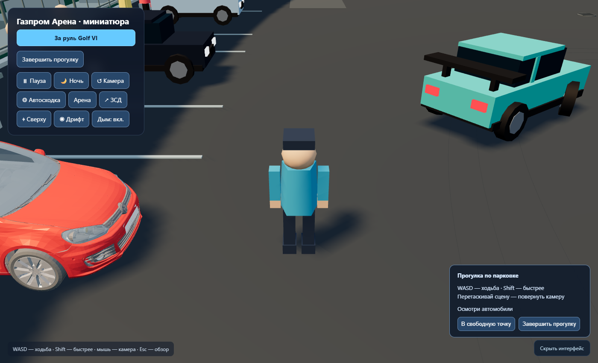
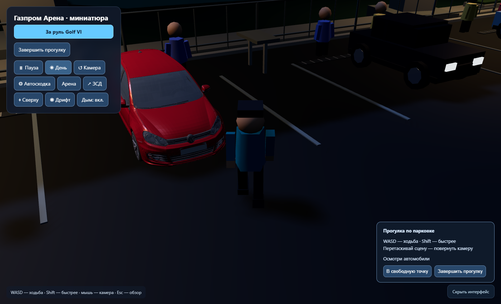

# Stage 7A — проверка прогулки

Ветка `feature/pedestrian-walking`, база `eda36dd`, 2026-10-14.

- `npm.cmd run build`: успешно; прежнее предупреждение Vite о размере bundle.
- `npm.cmd run test:core`: 67/67.
- `npm.cmd run test:pedestrian`: 12/12, движение при 15/30/60/144 FPS,
  коллизии/скольжение/берег/поверхности/переключение Golf.
- Полный `test:browser`: [80/80](full-report.json), прежние сценарии
  HUD/света/трафика/дрифта/Golf/мобильных педалей и новая прогулка.
- Финальный `test:pedestrian:browser`: [26/26](pedestrian-report.json),
  повторён после правки кепки/уточнения поверхности земли; добавлены
  настоящая ограда, тротуар и вода. Без console/page errors.
- Нормальная production dist не содержит `__readDiorama`/`__placePedestrian`.
  Начальные точки у GLB задавались fixture только в тестовой сборке;
  движение и столкновения проверены настоящими клавишами. Часы 60 Гц,
  Edge/SwiftShader, не измерение GPU FPS и не физический телефон.
- Исходные файлы финальной версии перечислены в `source-hashes.json`.
  Полный прогон предшествовал последнему уточнению пеших поверхностей;
  финальный профильный прогон и unit-тесты проверяют это уточнение.

Пять итоговых скриншотов визуально просмотрены. Это ревью, не baseline:

[Golf](pedestrian-golf.png) · [Lexus](pedestrian-lexus.png) ·
[Mercedes](pedestrian-mercedes.png)

Клавиатура обязательна для ходьбы; камера с фиксированной высотой и
дистанцией без отдельной системы устранения перекрытия вида. Пешеход
остаётся на земле, не поднимается по лестницам. Динамические машины
не меняют своего поведения; при окружении персонаж восстанавливается
в свободной точке. Посадка/пассажиры/мультиплеер вне этого этапа.
