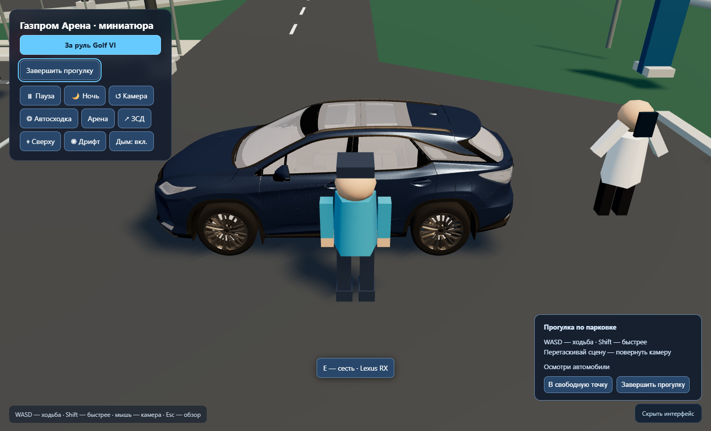
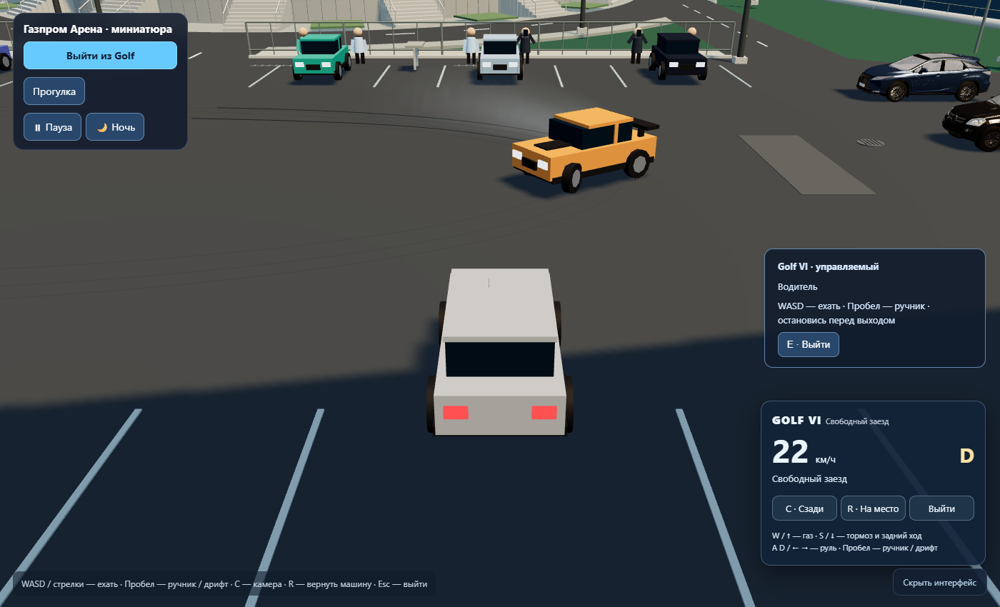
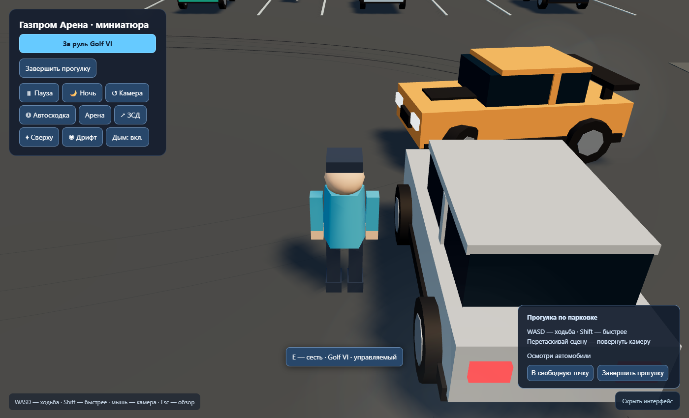

# Stage 7B — Vehicle Interaction & Seating

2026-10-14 (Europe/Moscow). Ветка `feature/vehicle-seating` от `d00a02a`.

Финальный код проверен после калибровки мест/сидячей позы и подключения
оставленного Golf к существующей логике уступания трафика/дрифта:

| Команда | Результат |
|---|---|
| `npm.cmd run build` | Успех; прежнее предупреждение Vite о размере bundle |
| `npm.cmd run test:seating` | 27/27 |
| Полный `npm.cmd test` — unit | 106/106 |
| Полный `npm.cmd test` — Edge/SwiftShader | 119/119, без console/page errors |
| `git diff --check` | Успех |

[Полный браузерный отчёт](report.json), [SHA-256 проверенных исходников](source-hashes.json).
Normal dist не содержит snapshot/fixture hooks. В private test build только
начальные позиции у дверей, занятое место и блокировка высадки задаются
fixtures; посадка, движение и выход проверяются настоящими клавишами и
кнопками. Часы браузера — 60 Гц. Это не GPU FPS-бенчмарк; мобильные педали
проверены через эмуляцию, а не физический телефон.

Unit-проверки покрывают все 18 автомобилей, car.localToWorld с родителем,
все четыре места, сохранение ID после замены GLB, occupied owner/release,
одну модель/общее состояние игрока, положение/курс при движении и R,
отказ при препятствии/скорости/повторной валидации, legacy shortcut,
физическую высадку без resetGolf, реальную систему дрифта перед оставленным
Golf и возврат к прежнему обзору. Браузер проверяет три GLB и процедурную
машину, пассажирское место, E/Esc/C, отказы, ручник, езду/высадку Golf,
день/ночь/пресеты и все прежние сценические сценарии.

Восемь кадров визуально просмотрены. Сохранены только новые снимки посадки;
прочие диагностические кадры полного набора остаются в ignored `_current`.
Утверждённые baseline не обновлялись.

| Автомобиль | У двери | После посадки |
|---|---|---|
| Красный Golf | [Дверь](seating-golf-door.png) | [Место](seating-golf-seated.png) |
| Lexus RX | [Дверь](seating-lexus-door.png) | [Место](seating-lexus-seated.png) |
| Mercedes GL | [Дверь](seating-mercedes-door.png) | [Место](seating-mercedes-seated.png) |

Ограничения: один локальный игрок, четыре условных места на каждой машине,
поза/координаты салонов откалиброваны вручную; мгновенная посадка без дверных
анимаций. GLB стекло может скрывать персонажа. Едет только прежний Golf[5];
остальные GLB/процедурные машины остаются статичными. Есть подготовленная
сериализация, без сервера/сети/видимых дополнительных пассажиров. Камера
сидения — два внешних вида; без интерьера и устранения перекрытий обзора.
