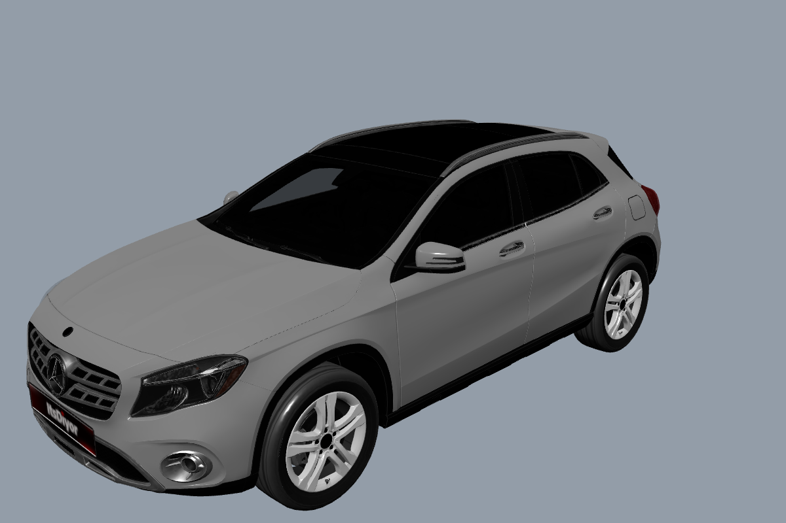
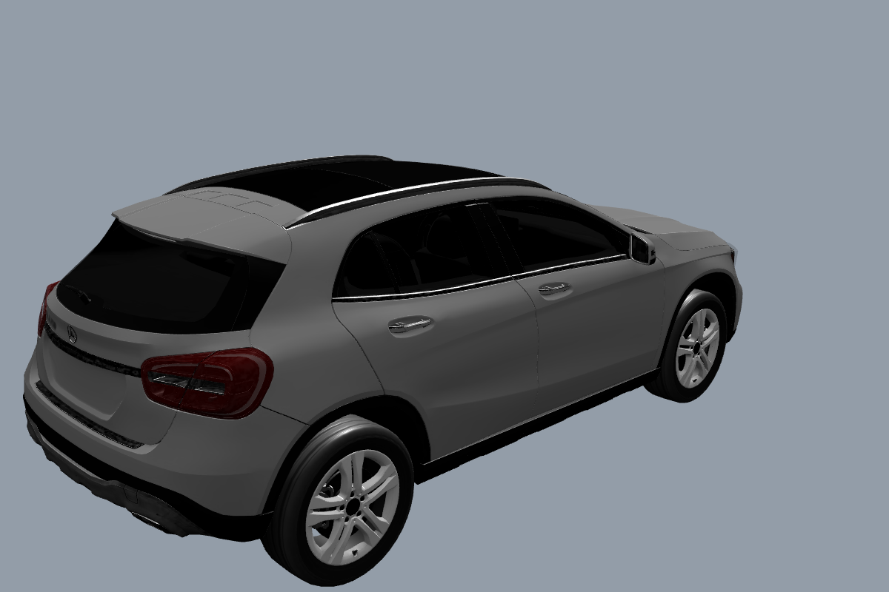
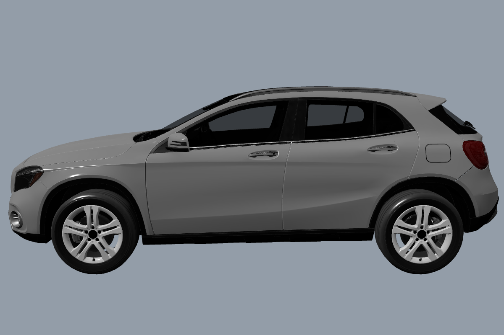

# Stage 7D - source rejected: X156 instead of H247

Base: origin/master cc3aaa7 (PR #8 merged). Branch feature/mercedes-gla-h247 in an isolated worktree.

Archive: main checkout public/models/cars/mercedes-benz_gla-class_2020.zip, 13,858,202 bytes. Contains scene.gltf, scene.bin, eight texture images and license.txt. Author ItsDiyor, CC BY 4.0. Original archive preserved; full audit and SHA-256 in audit.json.

The original glTF was rendered with Three.js in Edge/SwiftShader. Three actual browser captures are attached. Visual inspection identifies X156: separate circular front fog lamps, first-generation headlamp/body shape, large rounded rear lamps confined to the rear quarter panels. The requested H247 has different body/lighting shapes and split rear lamps extending onto the tailgate. The archive title '2020' does not establish generation.

Integration stopped as explicitly required by the user. A correct H247 source is required. No nineteenth car or application changes. Existing 18 cars, original assets, user files and visual baselines preserved. Build/unit/full browser suite were not run because application code did not change. No PR, merge or Production deployment.

Source metadata from archive (web request returned 403): https://sketchfab.com/3d-models/mercedes-benz-gla-class-2020-ab7b5df3ba634f38a14effde3d542466

Official H247 visual reference: https://www.mercedes-benz.com.sv/mercedes/site/docs/20200916/20200916225720/catalogo_nueva_gla.pdf

