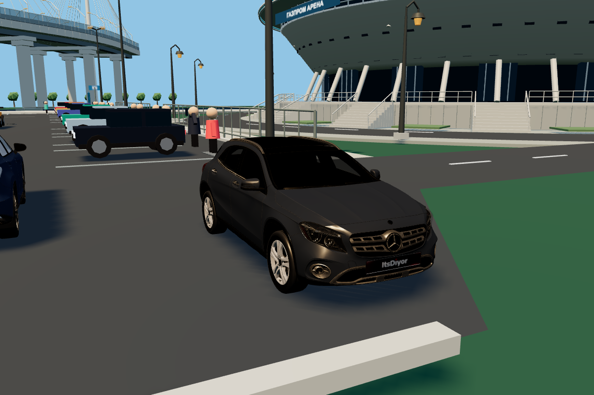
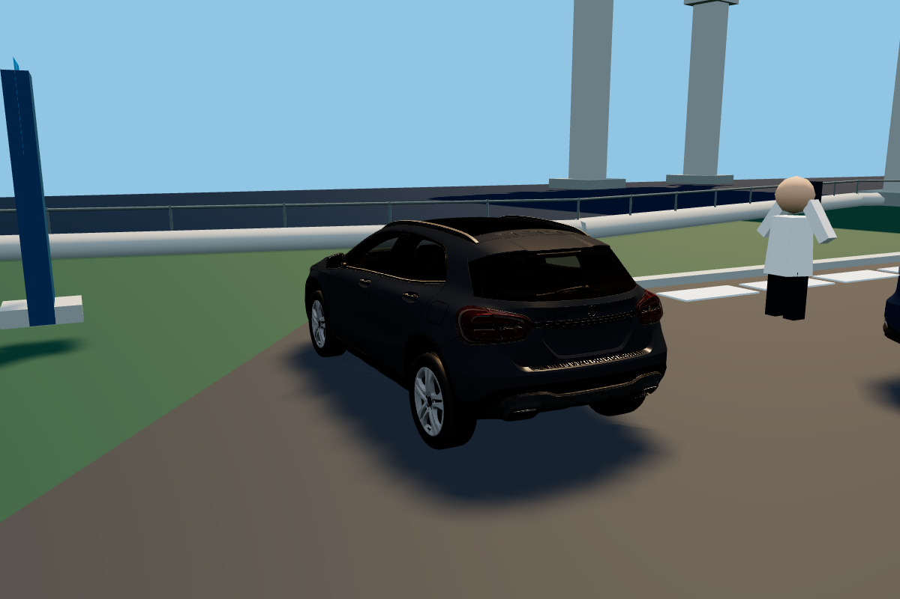
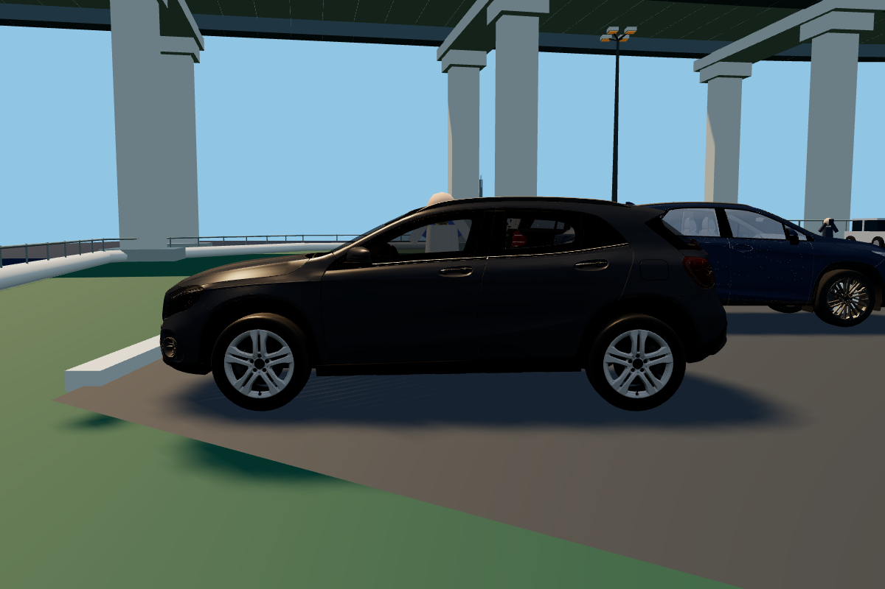
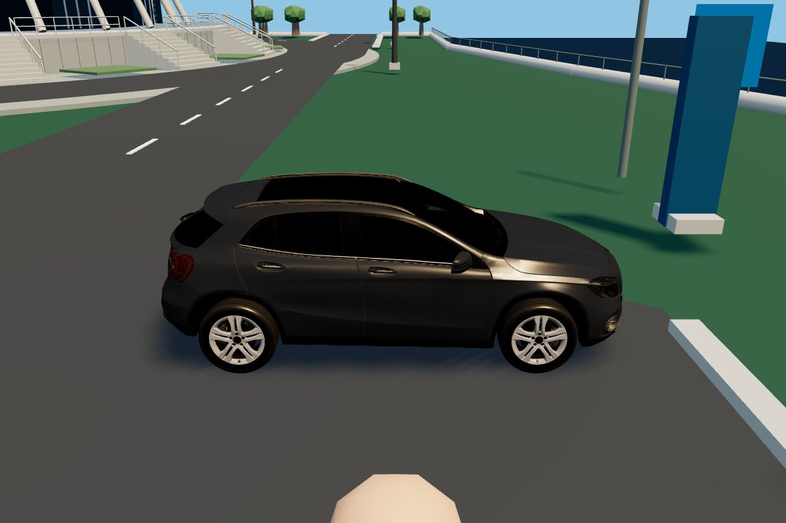
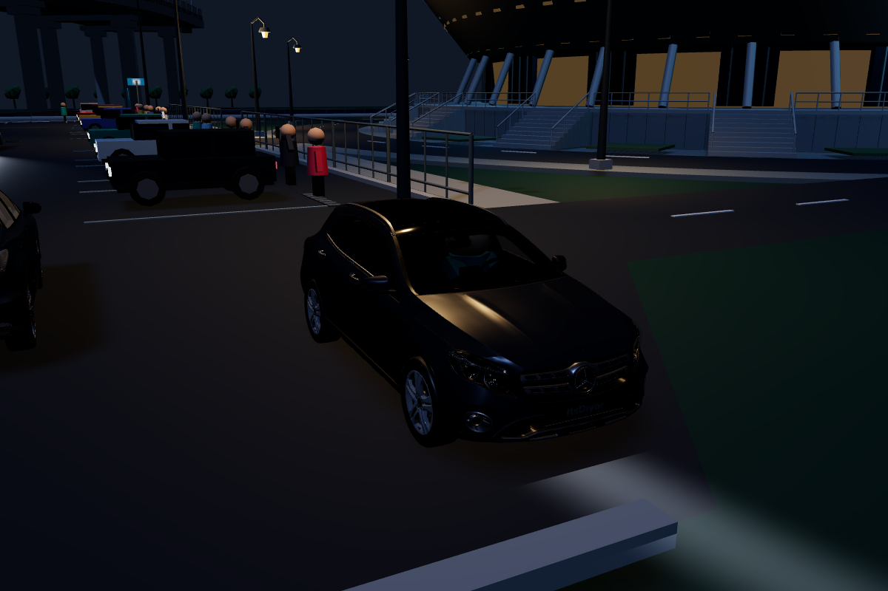
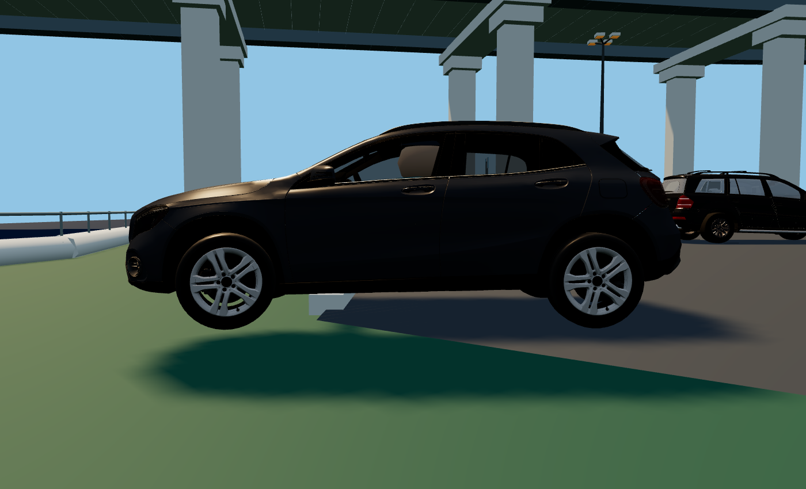
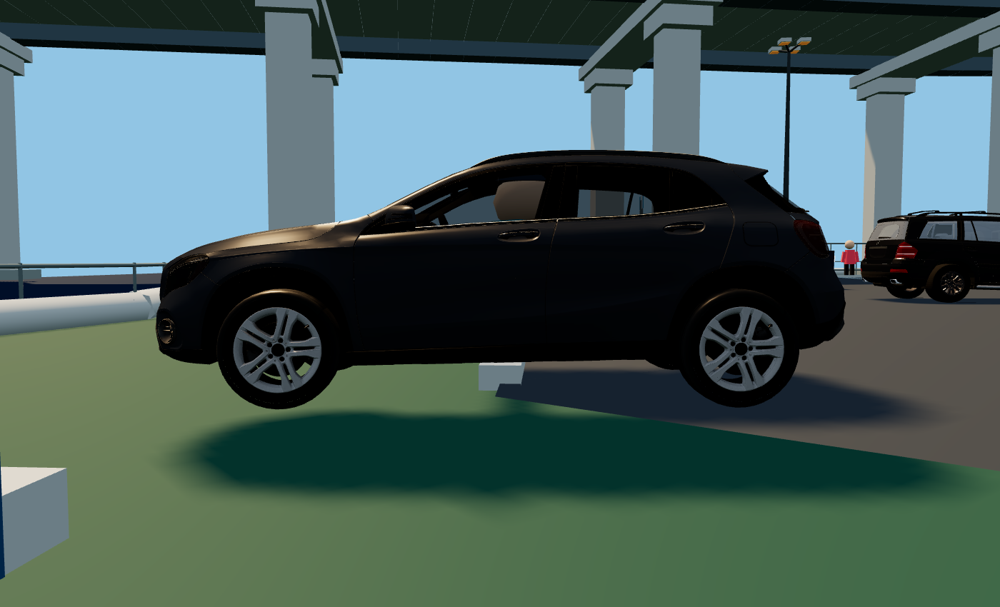

# Stage 7D — Mercedes-Benz GLA X156 — 2026-10-17

Чёрный GLA добавлен девятнадцатым самостоятельным автомобилем: `parked[18]`, ID `parked-mercedes-gla-x156`, место (6.5, 37), yaw -PI/2. Все прежние 18 ID, индексы и домашние позиции сохранены; Mercedes GL X166 остаётся отдельной машиной. Ветка `feature/mercedes-gla-x156` в прежнем безопасном worktree `mercedes-gla-h247`, база master `cc3aaa7` (PR #8 объединён).

Пользователь явно разрешил X156 вместо H247. Первоначальный [аудит источника](../2026-10-16-gla-source-audit/RESULTS.md) сохранён как история; его условие остановки отменено новым решением. Модель не называется H247 или неподтверждённой модификацией двигателя. H247 оставлен необязательной будущей моделью в ROADMAP.

## Источник и GLB

[Mercedes-Benz GLA-Class 2020](https://sketchfab.com/3d-models/mercedes-benz-gla-class-2020-ab7b5df3ba634f38a14effde3d542466), автор [ItsDiyor](https://sketchfab.com/ItsDiyor), [CC BY 4.0](https://creativecommons.org/licenses/by/4.0/). Авторство/источник/изменения записаны в `public/models/cars/ATTRIBUTION.md`, исходная лицензия сохранена рядом с моделью. Поколение X156 установлено визуально по геометрии, а не названию архива «2020».

| Параметр | Результат |
|---|---:|
| Новый файл | `mercedes_gla_x156_black_wheels.glb` |
| Размер GLB | 11 271 788 байт (11.27 MB) |
| Исходный glTF + BIN + 8 текстур | 19 573 702 байта |
| Снижение размера относительно распакованных исходников | 42.4% |
| Треугольники | 176 140, все исходные сохранены |
| Меши / материалы | 14 / 5 |
| Изображения | 8, не более 1024 px по каждой стороне |
| Измеренные длина × ширина с зеркалами × высота | 4.421901 × 2.015698 × 1.557959 м |
| Радиус колёс по геометрии | около 0.350920 м |

Геометрия компактно переиндексирована по используемым вершинам. Четыре дублирующих UV-канала удалены после побайтовой проверки равенства единственному оставленному каналу; ссылки текстур переведены на него. Кузов окрашен в чёрный, с металлическим блеском и равномерной лаковой шероховатостью. Материалы остальных частей сохраняют назначение и исходные текстурные атласы, уменьшенные по разрешению. Новых источников света нет, посадка не перезагружает модель. Исходный ZIP, пользовательский CONTEXT, резервные GLB/архивы и визуальные baseline сохранены. Golf/RX/GL и их три проверенные колёсные производные не изменены.

Воспроизведение: извлечь лицензированный ZIP, выполнить `tools/prepare-gla-textures.ps1 -Source <каталог>` в PowerShell, затем `node tools/prepare-gla-model.mjs <каталог>`. Подготовка текстур использует Windows System.Drawing; браузерных зависимостей это не добавляет.

## Настоящие колёса и управление

Источник содержит шесть мешей, объединённых по материалам; отдельные колёсные узлы отсутствуют. В атласе `Index_0_1` связные компоненты шин, дисков, роторов, крепежа и суппортов можно отделить без разрезания треугольников. Компоненты объединены в четыре rolling-меша и четыре fixed-меша суппортов (по три исходных компонента на сборку суппорта). Остальная геометрия остаётся кузовом. Это восемь дополнительных мешей для независимых трансформаций, а не сотни мешей по числу исходных компонентов. Полный разбор: [model-audit.json](model-audit.json).

Исходник Y-up, нос +Z, ось колёс X. После +PI/2 вокруг Y нормализованный автомобиль имеет нос +X и ось качения Z. Общий `wheelAnimation.js` использует Y для steeringPivot и -Z для положительного качения. Радиусы/центры получены из реальной геометрии. Угол растёт на фактическую принятую дистанцию / радиус, задний ход меняет знак; неподвижные колёса не катятся. Передние колёса рулятся, задние — нет; ручник блокирует качение задних. Суппорты наследуют только руление и никогда не вращаются с дисками. Кузов не вращается вместе с колёсами.

Четыре места откалиброваны под кабину и двери. E использует существующую систему посадки/безопасного выхода; пассажиры не получают управление. Единственный локальный контроллер `vehicleDrive.js` выбирает GLA через registry, с отдельными аркадными настройками. Выход сохраняет позу, повторная посадка продолжает поездку, R сбрасывает явно. Проверка повторной посадки допускает 1e-9 м: на траве сглаживание высоты оставляло численный остаток порядка 1e-13 м; физика ради теста не менялась.

## Проверки финального кода

- `npm run build` — успешно; остаётся прежнее предупреждение Vite о JS-бандле больше 500 kB.
- `npm run test:unit` — **125/125**, включая реальные части GLB, размеры/радиусы, суппорты, 19 ID/ролей и общие коллизии GLA с машиной, оградой и границей суши.
- `npm run test:browser` — **489/489**, Edge 155 / SwiftShader, без ошибок страницы/консоли. Полный прежний набор сохранён и расширен.
- Все 19 автомобилей прошли E → реальную езду клавишами → руление/качение → ручник/дым/следы → безопасный выход → повторную посадку. Во время пересадок проверены сохранённые позы всех ранее посещённых машин. Фикстуры расставляют только пешехода у дверей; проверяемое движение машин выполняет обычный контроллер с клавиатурным вводом.
- Для GLA отдельно проверены три пассажирских двери, запрет пассажирского управления, HUD с X156, общий ночной проектор, выезд из исходного места и остановка у настоящего препятствия на острове, R и физическая высадка.
- Для пяти типов машин проверены стоянка, передний/задний ход, руление, ручник, сохранение углов и отсутствие повторной загрузки. Для GLA сохранены шесть кадров с двух сторон с шагом 5/60 с; кватернионы всех четырёх колёс изменяются. Например, угол переднего левого колеса: 6.638534 → 7.607678 → 8.541146 рад. Задние колёса в этой серии катятся, их steering остаётся 0.
- Сохранены день/ночь, камеры/пресеты, HUD, мобильные кнопки, legacy Golf, ходьба, трафик и автоматический дрифт. Ресурсы не растут при повторных посадках: один запрос новой GLB на страницу, общие 90 частиц дыма / 4000 сегментов следов.

Подробности: [браузерный отчёт](browser-report.json), [unit](unit-tests.log), [build](build.log), [углы и позы между кадрами](wheel-sequence.json), [хеши проверенных файлов](source-hashes.json). [Галерея](review.html) содержит слайдер кадров; его переключение и загрузка всех изображений проверены в браузере ([результат](gallery-check.json)).

## Производительность относительно master cc3aaa7

Одинаковая полная сцена, дневной режим, пауза, камера у нового места; три чередующихся повтора в новых контекстах. Восемь шагов прогрева с отрисовкой последнего, затем 20 отдельно отрисованных кадров на повтор. Время замерено снаружи браузера вокруг RPC + кадр + gl.finish. Загрузка — локальный сервер, без имитации интернет-канала. Сырые данные: [performance.json](performance.json); воспроизведение — `node tools/gla-perf.mjs`.

| Метрика | master | С GLA |
|---|---:|---:|
| Draw calls основного прохода, renderer.info | 604 | 618 (+14) |
| Треугольники основного прохода | 1 154 218 | 1 330 358 (+176 140) |
| Геометрии / материалы / текстуры сцены | 1284 / 378 / 11 | 1298 / 383 / 19 |
| Сумма загруженных GLB, без HTTP-заголовков | 29.13 MB | 40.40 MB |
| Готовность всех моделей, медиана локального запуска | 356.80 мс | 468.61 мс |
| RPC-время кадра, медиана всех образцов | 27.57 мс | 11.70 мс |

Запрос самой GLA занял 43.3–49.4 мс на localhost. Сравнение времён кадра **сильно зашумлено**: в обоих вариантах есть выбросы порядка 1.2–6.6 секунды. Уменьшение медианы нельзя трактовать как улучшение FPS; эти данные также не доказывают отсутствие деградации на аппаратном GPU/телефоне. Надёжно установлены дополнительный размер загрузки и фиксированная стоимость ресурсов/геометрии/draw calls. Показатели renderer.info относятся к основному проходу и не заменяют полный GPU-профиль теней. Дополнительные источники света не создавались, Lexus не менялся, утечек и повторных загрузок в функциональном прогоне нет.

## Ограничения

Это прежняя аркадная кинематика, без подвески, Ackermann, дифференциала и деформации шин. На ступенчатой границе асфальт/трава высота сглаживается по центру машины; отдельное колесо может визуально оказаться над более низкой поверхностью до перехода центра. Дым/следы используют существующее приближение задней оси по footprint. Исходная кабина/остекление сохранены; двери не анимируются. Позы машин сохраняются в памяти текущей сессии, не между перезагрузками страницы. Дальнейшая оценка аппаратного/мобильного FPS остаётся отдельной проверкой.

## Снимки

Спереди:

Сзади:

Слева:

Справа:

Ночью, после физической посадки E, с общими активными фарами:

Езда с вращением колёс — кадры 0 и 2 (полная серия и обе стороны в галерее):

PR создаётся отдельно в master. Самостоятельный merge и Production не выполняются.
